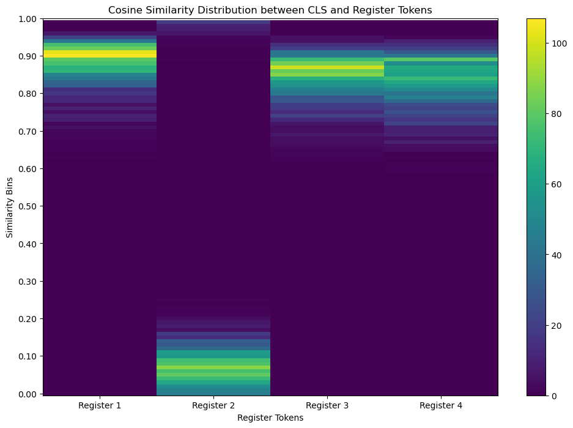

# What do register tokens store? Exploring DINOv2's registers

Vision transformers trained at scale develop artifacts: a few patch tokens with very high norms that hijack the attention maps. *Vision Transformers Need Registers* (Darcet et al., 2023) fixed this by adding extra **register tokens** to the model, but did not look at what those registers actually end up holding.

This project takes a pretrained DINOv2 model with 4 registers and asks three questions:

1. What information is stored in the register tokens?
2. Do they hold anything the CLS token does not?
3. Instead of being thrown away, can they help on downstream tasks?

Deep Learning course project, Tel Aviv University, 2024.

## Key findings

- **Reproduced the original result.** Without registers, the CLS attention map shows bright artifact spots. With registers, it cleanly covers the main object.
- **Registers carry global image information.** A classifier trained on a single register token comes within about 1 point of one trained on the CLS token on ImageNet-100.
- **One register is different.** Registers 1, 3 and 4 have a cosine similarity close to 1 with the CLS token. Register 2 sits near 0.1, almost orthogonal.
- **Outside the pretraining data, registers do better than CLS.** On COCO, which the model was not trained on, every register-based classifier beat the CLS-based one, and Register 2 did best.



*Distribution of cosine similarity between the CLS token and each register token across COCO 2014 images. Register 2 is almost orthogonal to CLS.*

## Results

Classification accuracy of a small classifier head trained on one token type at a time:

| Token | ImageNet-100 | COCO 2017 | COCO 2014 |
|---|---|---|---|
| CLS | **86.4%** | 66.4% | 65.5% |
| Register 1 | 85.4% | 66.9% | 67.0% |
| Register 2 | 78.8% | **67.8%** | **68.5%** |
| Register 3 | 85.2% | 66.9% | 67.0% |
| Register 4 | 84.9% | 66.3% | 66.5% |

Adding Register 2 to the CLS token (a separate training run, so the CLS numbers differ slightly from the table above):

| Input | ImageNet-100 | COCO 2017 | COCO 2014 |
|---|---|---|---|
| CLS | 86.1% | 66.4% | 65.5% |
| Register 2 | 78.5% | 66.9% | 68.5% |
| CLS + Register 2 | 86.0% | 66.8% | 67.5% |

A model trained to predict the CLS embedding from the 4 registers reached a minimum loss of 0.187 on ImageNet-100 and 0.204 on COCO.

**Interpretation.** DINOv2 was pretrained on ImageNet, so its CLS token already captures ImageNet images about as well as it can, and Register 2 adds nothing there. On COCO, Register 2 seems to hold information the CLS token misses, which suggests registers may be useful for downstream tasks on data unlike the pretraining set.

**Limitations.** Each number comes from a single training run, and the COCO evaluations use small subsets (for example, 1,000 images from COCO 2014). The COCO differences are a few points, so treat them as a signal worth testing further rather than a settled result.

## How it works

- **Model:** pretrained DINOv2 ViT-S/14 with 4 registers (`dinov2_vits14_reg`), frozen. Weights download automatically from Meta on first use.
- **Embeddings:** for each image, the CLS token, the 4 register tokens and the patch tokens are extracted from the model's output.
- **Attention maps:** DINOv2's attention code is modified to also return the register tokens and per-register attention maps. The modified copy lives in `dinov2/`; the original code will not work for this.
- **Classifiers:** a small neural-network head is trained on each token type separately, and on CLS + Register 2 concatenated.
- **Similarity:** Euclidean distance and cosine similarity between each register and the CLS token, per image.
- **COCO labels:** COCO images often contain several objects, so each image is labeled by the object with the largest bounding box.

## Repository structure

| Path | Contents |
|---|---|
| `notebooks/AttentionMaps.ipynb` | Extracting CLS and register attention maps |
| `notebooks/ImageNet100.ipynb` | Register exploration and classifiers on ImageNet-100 |
| `notebooks/COCO2014.ipynb` | The same analysis on COCO 2014 |
| `notebooks/COCO2017.ipynb` | The same analysis on COCO 2017 |
| `compute_embeddings.py` | Computes and saves ImageNet-100 embeddings |
| `dataloader.py`, `embedding_utils.py`, `model_utils.py` | Data loading, embedding and model helpers |
| `dinov2/` | Meta's DINOv2 code, modified to return register tokens |
| `assets/` | Figures used in this README |

Read the notebooks in the order above.

## Running it

```bash
pip install -r requirements.txt
```

1. **ImageNet-100:** download it from [Kaggle](https://www.kaggle.com/datasets/ambityga/imagenet100/data) into `Imagenet100/`.
2. **Embeddings:** run `python compute_embeddings.py` to compute the ImageNet-100 embeddings into `Imagenet100/train_embeddings` and `Imagenet100/val_embeddings`. They are not stored in the repository because of their size.
3. **COCO:** COCO 2014 is loaded in the notebook from Hugging Face (`load_dataset("detection-datasets/coco")`). COCO 2017 comes from [cocodataset.org](https://cocodataset.org/#download).
4. Open the notebooks.

## Credits

- Based on *Vision Transformers Need Registers*, Timothée Darcet, Maxime Oquab, Julien Mairal and Piotr Bojanowski, 2023 ([arXiv:2309.16588](https://arxiv.org/abs/2309.16588)).
- `dinov2/` is adapted from [facebookresearch/dinov2](https://github.com/facebookresearch/dinov2), © Meta Platforms, Inc., under the Apache License 2.0 (see `dinov2/LICENSE`). It was modified to return register tokens and their attention maps.
